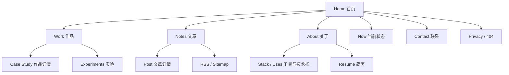

# 个人网站第一版信息架构与线框规格

## 1. 站点地图



导航建议保持 4 个一级入口：`Work`、`Notes`、`About`、`Contact`。`Experiments`、`Stack`、`Now` 可以作为首页模块或 About 下的二级入口，避免首屏导航过重。

## 2. 首页线框规格

### 桌面端

```text
┌─────────────────────────────────────────────────────────────────────────────┐
│ ZY / PERSONAL                         Work  Notes  About  Theme              │
├─────────────────────────────────────────────────────────────────────────────┤
│ [身份标签]                                                                   │
│                                                                             │
│ 我设计并构建                                                                  │
│ 可被使用的数字产品                                                           │
│ 一句补充定位，说明行业、角色和合作方向。                                      │
│ [查看作品]  [联系我]                                                         │
├─────────────────────────────────────────────────────────────────────────────┤
│ SELECTED WORK / 01—03                                                       │
│ ┌──────────────────┐ ┌──────────────────┐                                   │
│ │   项目封面图      │ │   项目封面图      │                                   │
│ │ 项目名 / 角色     │ │ 项目名 / 角色     │                                   │
│ └──────────────────┘ └──────────────────┘                                   │
│ ┌──────────────────┐ ┌──────────────────┐                                   │
│ │   项目封面图      │ │   项目封面图      │                                   │
│ └──────────────────┘ └──────────────────┘                                   │
├─────────────────────────────────────────────────────────────────────────────┤
│ NOW                                  LATEST NOTES                            │
│ 当前关注主题、状态和可合作时间。           文章标题 / 日期 / 阅读时间。       │
├─────────────────────────────────────────────────────────────────────────────┤
│ Available for selected projects                                      Email ↗│
└─────────────────────────────────────────────────────────────────────────────┘
```

### 移动端

```text
┌───────────────────────────┐
│ ZY                    Menu │
├───────────────────────────┤
│ [身份标签]                 │
│                           │
│ 我设计并构建               │
│ 可被使用的数字产品        │
│ 一句补充定位。             │
│ [查看作品]                 │
├───────────────────────────┤
│ SELECTED WORK              │
│ ┌───────────────────────┐ │
│ │      项目封面图       │ │
│ │ 项目名 / 角色         │ │
│ └───────────────────────┘ │
│ ┌───────────────────────┐ │
│ │      项目封面图       │ │
│ └───────────────────────┘ │
├───────────────────────────┤
│ NOW                       │
│ 当前状态和主题。           │
├───────────────────────────┤
│ LATEST NOTES              │
│ 文章标题                  │
│ 文章标题                  │
├───────────────────────────┤
│ Email ↗                   │
└───────────────────────────┘
```

首页设计规则：首屏只保留一个主标题和两个动作；作品卡片优先展示结果和角色，不在卡片里塞完整过程；移动端项目单列，图片比例统一，避免页面跳动。

## 3. 作品详情页线框规格

### 桌面端

```text
┌─────────────────────────────────────────────────────────────────────────────┐
│ ← Back to work                                             Next project →   │
├─────────────────────────────────────────────────────────────────────────────┤
│ [项目类型]                                                                  │
│ 项目名称                                                                     │
│ 一句话说明项目价值、你的角色和结果。                                         │
│                                                                             │
│ Role / Product design       Year / 2026       Team / 03 people             │
├─────────────────────────────────────────────────────────────────────────────┤
│                                                                             │
│                         首屏主视觉 / Demo                                   │
│                                                                             │
├──────────────────────────────┬──────────────────────────────────────────────┤
│ 页面目录                       │ 01 / Context                                 │
│ Overview                      │ 背景、用户、问题和约束。                      │
│ Challenge                     │                                              │
│ Approach                      │ 02 / Process                                 │
│ Outcome                       │ 研究、方案、迭代和关键决策。                  │
│ Reflection                    │                                              │
│                              │ [图片] [图片]                                 │
│                              │                                              │
│                              │ 03 / Outcome                                  │
│                              │ 最终方案、数据、影响和复盘。                    │
├──────────────────────────────┴──────────────────────────────────────────────┤
│ ← 上一个项目                                      下一个项目 →               │
└─────────────────────────────────────────────────────────────────────────────┘
```

### 移动端

```text
┌───────────────────────────┐
│ ← Work               Next →│
├───────────────────────────┤
│ [项目类型]                 │
│ 项目名称                   │
│ 一句话项目说明。           │
│ Role / Year / Team         │
├───────────────────────────┤
│       首屏主视觉          │
├───────────────────────────┤
│ Overview                  │
│ 背景、问题和目标。         │
├───────────────────────────┤
│ Process                   │
│ 图片 / 过程说明。          │
├───────────────────────────┤
│ Outcome                   │
│ 结果、数据和复盘。         │
├───────────────────────────┤
│ ← 上一个项目              │
│ 下一个项目 →              │
└───────────────────────────┘
```

案例详情页建议使用统一内容模型：

```yaml
title: 项目名称
slug: project-slug
year: 2026
role: Product design
team: [Designer, Engineer]
tags: [AI, SaaS]
cover: /images/project-cover.avif
summary: 一句话项目说明
sections:
  - type: context
  - type: process
  - type: gallery
  - type: outcome
  - type: reflection
```

## 4. 设计令牌落地规则

令牌文件：

- [design-tokens.css](C:/Users/Kain Yin/documents/Codex/2026-11-17/zjyin9-yg42y-29-codex-threads-01a1d376/outputs/design-tokens.css)
- [design-tokens.json](C:/Users/Kain Yin/documents/Codex/2026-11-17/zjyin9-yg42y-29-codex-threads-01a1d376/outputs/design-tokens.json)
- [tailwind.tokens.js](C:/Users/Kain Yin/documents/Codex/2026-11-17/zjyin9-yg42y-29-codex-threads-01a1d376/outputs/tailwind.tokens.js)

使用约束：

1. 页面背景只使用 `--color-bg`，内容表面只使用 `--color-surface`。
2. 主 CTA 使用 `--color-accent`，每个区域最多一个高强调动作。
3. 正文使用 `--font-sans`，大标题可使用 `--font-display`，技术标签使用 `--font-mono`。
4. 页面宽度使用 `--container-max`，左右留白使用 `--gutter`。
5. 动画统一使用 `--motion-*` 和 `--ease-standard`，不在组件中写散落的过渡时间。
6. 所有图片预留固定宽高比，避免加载时页面跳动。
7. 主题切换只改变令牌值，不复制两套组件样式。

## 5. 第一轮实现顺序

1. 先实现全局布局、主题令牌、导航和按钮。
2. 实现首页和作品详情页的静态内容模型。
3. 加入响应式断点和移动端单列布局。
4. 加入文章、实验、Now 页面。
5. 最后添加页面转场、悬停预览、搜索和统计。
